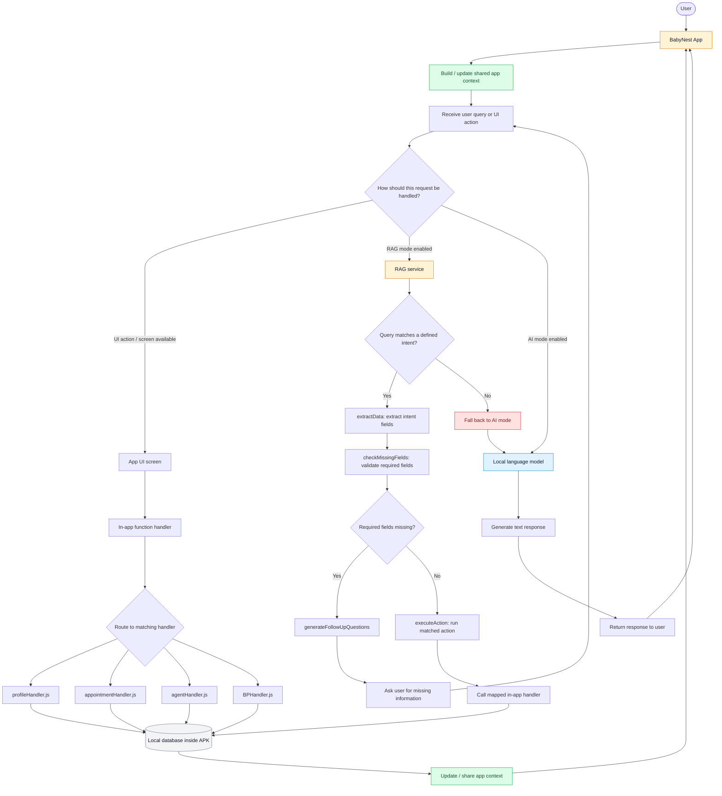

# BabyNest
<div name="readme-top"></div>

<!-- Organization Logo -->
<div align="center" style="display: flex; align-items: center; justify-content: center; gap: 16px;">
  
  
</div>

&nbsp;

<!-- Organization Name -->
<div align="center">


<!-- Correct deployed url to be added -->

</div>

<!-- Organization/Project Social Handles -->
<p align="center">
<!-- X (formerly Twitter) -->
<a href="https://twitter.com/aossie_org">
</a>
&nbsp;&nbsp;
<!-- YouTube -->
<a href="https://www.youtube.com/@AOSSIE-Org">

&nbsp;&nbsp;
<!-- Discord -->
<a href="https://discord.gg/hjUhu33uAn">
</a>
&nbsp;&nbsp;

BabyNest is an **Offline React Native Privacy-Focused mobile application** for pregnancy tracking, health-record management, and AI-assisted support.

> **Medical disclaimer:** BabyNest is an organizational and informational tool, not a substitute for professional medical advice, diagnosis, treatment, or emergency care.

## 🚀 Features

- **Offline AI-Powered Chat**: Local GGUF LLM with user context integration & RAG support
- **Task Management**: View tasks & appointments by pregnancy week with priority sorting
- **Health Tracking**: Weight, symptoms, medications, blood pressure
- **Manage pregnancy** related tasks and appointments.

- Visualize pregnancy progress with a week-by-week timeline in graphical form.
- Store structured app data in a local SQLite database.

## Prerequisites

For Android development, install:

- Node.js and npm
- JDK 17
- Android Studio and Android SDK Platform 35
- Android SDK Build-Tools 35.0.0
- Android NDK `27.1.12297006`
- An Android device with USB debugging enabled, or an Android emulator

The current Android configuration specifies `minSdkVersion 24`, `compileSdkVersion 35`, `targetSdkVersion 34`, and Kotlin `2.0.21`. Check the Gradle files in your checkout if these values change.

See the official [React Native 0.77 environment setup guide](https://reactnative.dev/docs/0.77/set-up-your-environment) for environment configuration.

## 🛠️ Installation

1. **Clone the repository**
   ```bash
   git clone https://github.com/AOSSIE-Org/BabyNest.git
   cd BabyNest
   ```

2. **Install dependencies**
   ```bash
   npm install
   # or
   pnpm install
   ```

3. **Environment Setup**
   
   Create a `.env` file in the Frontend directory:
   ```env
   # API Configuration
   BASE_URL=http://localhost:5000
   
   # Model Configuration
   MODEL_NAME="Qwen2-0.5B-Instruct"
   HF_TO_GGUF="Qwen/Qwen2.5-0.5B-Instruct-GGUF"
   GGUF_FILE="qwen2.5-0.5b-instruct-q4_k_m.gguf"
   DOWNLOAD_URL=`https://huggingface.co/${HF_TO_GGUF[MODEL_NAME]}/resolve/main/${GGUF_FILE}`
   ```

4. **Install React Native dependencies**
   ```bash
   npx react-native link
   ```
> Check the [Setup.md](./Setup.md) file for additional setup instructions for Android and iOS.

## 🤖 AI Model Setup

### Model Download

The app uses a local GGUF model for chat responses. The model will be automatically downloaded on first use.

**Model Details:**
- **Model**: Qwen2-0.5B-Instruct
- **File**: qwen2.5-0.5b-instruct-q4_k_m.gguf

### Model Configuration

The model is configured in `src/model/model.jsx`:
- **Context Window**: 32,768 tokens
- **Generation limit**: 8,192 tokens
- **Parameters**: 0.49 billion
- **Model file size**: ~469 MiB

## 📱 App Structure

This is the current directory structure for the Frontend app:

```text
BabyNest/
├── .bundle/
│   └── config
├── .env
├── .env.example
├── .eslintrc.js
├── .gitignore
├── .prettierrc.js
├── .watchmanconfig
├── __tests__/
│   ├── App.test.tsx
│   └── EmergencyCallingScreen.test.js
├── android/
├── ios/
├── src/
│   ├── Components/
│   ├── Screens/
│   ├── assets/
│   ├── context/
│   ├── data/
│   ├── database/
│   ├── hooks/
│   ├── model/
│   ├── navigation/
│   ├── services/
│   ├── storage/
│   ├── theme/
│   └── utils/
├── App.jsx
├── Gemfile
├── Gemfile.lock
├── index.js
├── jest.config.js
├── metro.config.js
├── package-lock.json
├── package.json
├── pnpm-lock.yaml
├── react-native.config.js
├── README.md
├── RAG_COMMANDS.md
├── Setup.md
├── app.json
└──  tsconfig.json
```

### Key Features

#### 1. Health Context Integration
```javascript
// Context-aware conversation building
  const {context, refreshContext, initializeContext,      isInitialized} = useAgentContext();
```

#### 2. Task Management
```javascript
  const filteredTasks = tasks
    .filter(task => {
      // Filter by week
      const weekMatch =
        task.starting_week <= currentWeek && task.ending_week >= currentWeek;

      // Filter by status
      if (filter === 'pending')
        return weekMatch && task.task_status === 'pending';
      if (filter === 'completed')
        return weekMatch && task.task_status === 'completed';
      return weekMatch;
    })
    .sort((a, b) => {
      // Sort by priority first, then by starting week
      const priorityOrder = {high: 3, medium: 2, low: 1};
      const priorityDiff =
        priorityOrder[b.task_priority] - priorityOrder[a.task_priority];
      if (priorityDiff !== 0) return priorityDiff;
      return a.starting_week - b.starting_week;
    });
```

#### 3. AI & RAG Chat Integration
```javascript
const textToSend = typeof content === 'string' ? content : userInput;

    if (!textToSend?.trim()) return;

    let finalMessage = textToSend.trim();

    if (isQuickReply && pendingQueryRef.current) {
      finalMessage = `${pendingQueryRef.current}. ${finalMessage}`;
    }

    // Store this query as context for a possible follow-up.
    pendingQueryRef.current = finalMessage;

    setUserInput('');

    // Message sending and core logic handled by hook
    const result = await sendMessage(textToSend, useRAGMode, initializeContext);
```

## Running the App

### Development

1. **Start Metro bundler**
   ```bash
   npx react-native start
   ```

2. **Run on Android**
   ```bash
   npx react-native run-android
   ```

3. **Run on iOS**
   ```bash
   npx react-native run-ios
   ```

### Production

1. **Build Android APK**
   ```bash
   cd android
   ./gradlew assembleRelease
   ```

2. **Build iOS**
   ```bash
   cd ios
   xcodebuild -workspace BabyNest.xcworkspace -scheme BabyNest -configuration Release
   ```

## 🔄 Data Flow

### Flow diagram



### Request-routing logic

``` text
Build/share app context
        |
        v
Receive query or UI action
        |
        +-- User selects an available UI screen/action
        |       -> In-app function handler
        |       -> Matching feature handler
        |       -> Local database, if required
        |       -> Update/share context
        |
        +-- ragMode == true
        |       -> RAG service searches for a defined intent
        |       -> Intent found?
        |            -> Yes: extract data
        |            -> Check required fields
        |            -> Missing fields: ask follow-up question and wait
        |            -> All fields present: execute mapped action
        |            -> No intent match: fall back to local AI mode
        |
        +-- aiMode == true
                -> Local language model
                -> Generate text response
                -> Return response to the user
```
## 🧪 Testing

### Run this cmd for Testing in root dir: -
```bash
npm test
```

## 🔧 Troubleshooting

### Common Issues

1. **Model Not Loading**
   - Check internet connection for download
   - Verify sufficient storage space
   - Check `.env` file configuration

3. **Context Not Loading**
   - Check context agent initialization
   - Verify database setup
   - Check user profile exists

### Debug Commands

```bash
# Check model status
adb logcat | grep "Model"

# Check API calls
adb logcat | grep "fetch"

# Check context loading
adb logcat | grep "Context"
```

## 🔒 Security Considerations

- **Local Model**: GGUF model runs locally, no data sent to external APIs
- **Health Data**: Stored locally in SQLite database
- **Context Privacy**: User health data only used for local AI responses
- **Offline Capability**: Chat works without internet connection

## 🚀 Performance Optimizations

- **Model Caching**: GGUF model loaded once per session
- **Context Caching**: User context cached with hash-based invalidation
- **Lazy Loading**: Model loads only when ChatScreen is accessed
- **Memory Management**: Automatic model cleanup on component unmount

## 📈 Future Enhancements

- [ ] Multi-user support
- [ ] Real-time health monitoring
- [ ] Advanced analytics dashboard
- [ ] Integration with health devices
- [ ] Better RAG services
- [ ] Voice chat interface

## 🤝 Contributing

Please read [CONTRIBUTING.md](./CONTRIBUTING.md) before submitting a change. Include clear reproduction steps with bug reports, and never include passwords, tokens, or private health information in issues or logs.

## 📄 License

See the repository's [`LICENSE.md`](./LICENSE.md) for the applicable license.

## 📝 Copyright
© 2026 AOSSIE-Org. All rights reserved. See [COPYRIGHT.md](./COPYRIGHT.md) for details on usage and warranty disclaimers.
